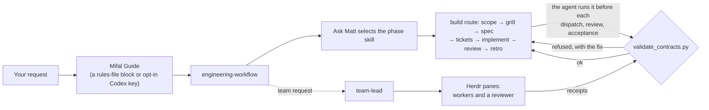

# Mifal

**One engineering workflow for the coding agents on your Mac, and the paperwork it leaves behind.**

A brief that names every claim, a receipt that answers each one, and a validator that refuses a record missing its required sections.

[](https://github.com/romiluz13/mifal/actions/workflows/test.yml)   [](LICENSE)

**[The Mifal website](https://romiluz13.github.io/mifal/)**: the build replay you can scrub through, the gate, and the install run.

An agent's "done" message is not independent proof that the work passed its checks. Mifal detects five agent families (Claude Code, Codex, Droid, Pi and OpenCode) and installs one Guide into the selected Homes it can wire, one or several per agent; a precedence conflict or a symbolic rules file can make it skip an agent or refuse the install. It also installs the same 39 skills (Matt Pocock's engineering skills run as ordered phases, plus DDD, review and team leading) and a contract validator that refuses a brief, receipt or phase record that lacks its required fields and checks selected identities and hashes; it does not verify that tests ran or that skills were invoked. `--dry-run` previews the planned changes; a plain install prints a short summary and writes. Uninstall removes what Mifal wrote that is unchanged and keeps any file you edited.

## What you get

- 🧭 **One workflow, five agents.** For each selected home that can be wired, the installer adds the same Guide. The Guide instructs the agent to load `engineering-workflow` before an engineering request, name its owner, route, phase and next gate, and ask whether you want the full workflow or a cut; Mifal does not force that invocation. A multi-session build runs scope → grill → spec → tickets → implement → review → retro in order; research, planning, debugging and review take shorter routes. `mifal doctor` checks the recorded install, the Guide blocks and the configured skill paths; it does not start agents or prove they loaded the Guide or the skills.
- 📋 **A brief, not a prompt.** The lead writes each task as a file before work starts: why it matters, what done looks like, the claims that must hold with the check behind each one, a stop rule, and the line it is **least sure of**, the assumption most likely wrong and the observation that would settle it. It makes the uncertainty specific enough to investigate.
- 🧾 **A receipt, not a "done".** The worker answers every claim in the brief with passed, failed or untested, cites the revision it checked and points at what it ran; an omitted claim keeps the receipt invalid, never passed.
- 🏠 **Several Homes of one agent.** `--home NAME=PATH`, repeatable, names each Home; for a Harness named this way only those Homes are served, and a reinstall keeps every Home already recorded (only `mifal uninstall` drops one). A Codex Home whose rules file is a link is served through one Mifal-marked `developer_instructions` key in its own `config.toml`, every other byte kept; a Home with its own `SessionStart` hook is recorded pending and the hook is never edited. `mifal doctor` prints one line per recorded Home and names an unrecorded Home that reads a shared rules file.
- 🛡️ **Gates that refuse.** The Guide has the agent run `validate_contracts.py` before every dispatch, review and acceptance. A record that lacks its required fields is refused with a diagnostic, and a passing record still needs its cited work and evidence reviewed:

  ```text
  $ python3 ~/.agents/skills/team-lead/scripts/validate_contracts.py brief .team/tasks/7.md --matt
  error: .team/tasks/7.md: missing section '## Done means'; the brief contract requires: Why, Outcome, Done means, Stop rule
  error: .team/tasks/7.md: missing '## Workflow' for the Matt check; add one before '## Return', e.g.:
    ## Workflow
    Methodology: matt
    ...
  ```
  The validator reads records; it does not run your tests or prove an agent loaded a skill. [docs/TRUST.md](docs/TRUST.md) draws that line.

- ↩️ **Previewed, and undone where unchanged.** `--dry-run` lists the planned changes before anything changes. Your own rules files keep everything you wrote; Mifal adds one Marked block, or the opt-in Codex key described below. `mifal uninstall` removes unchanged managed files, links and blocks, preserves your edits and additions, and restores a moved-aside backup only when its target is free (otherwise it keeps and reports the backup); Herdr stays installed.
- 👥 **A team, not a single chat.** The team lead skill has the lead brief agents in [Herdr](https://herdr.dev) panes, check their receipts with the validator, and send their work to a reviewer before accepting it.

## Where the lead's authority ends

The lead is an agent too, so Mifal trusts it no further than its evidence. The Guide routes it to the engineering and team-lead procedures, which require these limits. The validator checks the records where it can; it does not enforce the agent’s behavior.

- **It cannot approve its own plan.** Another agent grills the plan in rounds until no question is left open, and the validator refuses a grilling owned by the plan's author. A design change needs a new grilling; a scope change still needs the appropriate approval.
- **It cannot cut a step.** Only the person who asked can drop part of the workflow, and the cut is recorded in their own words with where they said it: `Cut: <steps> | <quote> | <source>`. Silence is not a cut.
- **It cannot accept a claim it cannot check.** The lead must compare the work and its evidence at the declared revision; a valid receipt alone is not proof that the work passed. A failed required check keeps acceptance open.
- **It cannot blame the model first.** When work fails, the lead checks the brief, the context and the tools before it changes the assignment, and it treats "everyone agreed" as a warning rather than proof: agents are trained to agree. The output is one rule with a trigger, an owner and a check.

## Quickstart

You need macOS, git and Python 3.9 or later; verify them with `git --version` and `python3 --version` (`xcode-select --install` provides them on the tested Mac). The dry run lists every write and changes nothing. If Herdr is missing, the installer shows `brew install herdr` in the dry run first; without Homebrew it shows Herdr's install script checksum and asks before running it, and without a terminal it stops unless you pass `--herdr-script`.

```sh
git clone https://github.com/romiluz13/mifal.git
cd mifal
./install.sh --dry-run
./install.sh
```

The install puts the `mifal` command in `~/.local/bin`; if that folder is not on your PATH, the installer prints the line to add to `~/.zprofile`. Then check the install:

```sh
mifal doctor
```

Start a session in any agent Mifal wired, in a project folder, and ask for engineering work as you normally would. The Guide tells the agent to scope the request, ask whether you want the full workflow or a cut, and work phase by phase. For a team, start the session inside Herdr (`herdr`) and ask for one.

## How it works



By default, Mifal's files live in your home folder: the engine in `~/.agents/mifal/`, the skills in `~/.agents/skills/`, and one Marked block in each successfully wired Home's rules file, or one marked key in a linked Codex Home's own `config.toml`; an outside-home root needs `--allow-root-outside-home`, and Herdr's installation has its own effects described in INSTALL.md. Mifal wires only the five agent families above: other tools, Gemini say, are not served; it never edits an agent's hooks. The marked Codex key is the only agent setting it writes. [docs/INSTALL.md](docs/INSTALL.md) lists every write, and covers update, rollback, uninstall and several Homes of one agent.

## Built by its own team


Mifal 0.1 was built by a Mifal team: a Claude lead, a Codex reviewer, a Claude researcher, and an outside critic for the final plan. Every mark is an event from the build record and `git log`. The reviewer said HOLD five times, with 21 blocking findings across those rounds (a few were what remained of an earlier finding), and all were closed before the public release.

## Status

**Alpha**, version 0.3.0. The installer, update, uninstall, doctor and validator are covered by tests, run in CI on macOS under the system Python and the current python3. What a program checks, and what still relies on the agent following the Guide, is spelled out in [docs/TRUST.md](docs/TRUST.md).

## Support

Mifal is agent-agnostic: it detects the five agent families on your Mac — Claude Code, Codex, Droid, Pi and OpenCode — and gives each one it can wire the same Guide and the same 39 skills, one Home or several per agent. `mifal doctor` reports what it wired.

macOS is the supported platform; Linux and Windows are not supported in this release.

One live check is recorded: one Mac on 2026-10-25, run on the 0.2.4 code before this release's changes; the session records are kept by the maintainer, not in this repository. Each row of that record is one agent version and one model, checked at four levels: **L1**, a first session that quotes the Guide and names Mifal's skills; **L2**, the method working alone — the agent shows its route and checklist and asks "Full workflow or cut?" before editing, which is the entry gate; **L3**, a team worker that completes a brief from a lead and passes `receipt --matt`, with one ring to the lead; and **L4**, a team lead that delivers one lead, one worker, one small task (a failing test in a small fixture) through Herdr, both records passing the validator. Read it with these limits:

- **One row per version and model, and how far it got.** The recorded rows: Claude Code 2.1.310 with Sonnet 5.5 and with Opus 5.5; Codex 0.164.0 with GPT-6.1-Sol (its `codex-work` home); Droid 0.249.0 with GLM 5.3; Pi 1.4.0 with Claude Sonnet 5 via GitHub Copilot (`pi -ne`); OpenCode 1.19.4 with GLM-5.3-Flash Free and DeepSeek V4.1 Flash Free. L1 was partial on every row (a skill went unnamed or the Guide never arrived). L2 was partial on Claude Code, Codex and Droid, and failed on Pi and OpenCode, which edited before asking. L3 passed on every row. L4 was run once per family and passed, except the Claude Code 2.1.310, Opus 5.5 row, which was not run.

- **No agent passed the entry gate as written.** The check asks for a phase-record file, and an agent working alone keeps its checklist in chat, so `validate_contracts.py workflow --gate entry` has nothing to run on. Pi and OpenCode (two attempts each) edited before asking.
- **Guide arrival was partial on the 0.2.4 code.** Some recorded sessions did not name `ask-matt`, and on that code Codex (its `codex-work` home) and OpenCode received no Guide at all. This release writes OpenCode's `~/.config/opencode/AGENTS.md`, and the installer serves the Codex home that `CODEX_HOME` names; neither has been rechecked live yet.
- **Every family completed a brief and passed `receipt --matt`.** One lead, one worker, one small task per family was delivered through Herdr; that is one real small task each, not a measure of reliability.
- **The lead loop is experimental.** The Herdr adapter and the lead loop under `~/.agents/mifal/tools/` are tested with fake agents; before this release an installed copy could not import the loop's `lead`, `wake`, `preflight` and `resume` modules; they import now, which a test checks, but the loop has not been run end to end on an installed copy.
- **Skill filters are invisible to `mifal doctor`.** Agent-level settings can hide Mifal's skills while doctor passes: Pi's `skills` setting (and a `.gitignore` inside a skills folder, which Pi honours), Droid's `disabledSkills`, Codex's `[[skills.config]]`, and OpenCode's `permission.skill`. In the recorded run Pi hid nine of Mifal's skills, including `engineering-workflow` and `team-lead`, because of a `.gitignore` in the skills folder.
- **There is no sandbox or isolation between agents.** Worktrees are a Guide rule, not enforced; recovery from a stuck worker is one budgeted resume action that the lead runs, not a watchdog.
- **Several Homes per agent and the linked Codex key are new and not live-checked.** `--home` installs one Guide into every named Home, and a linked Codex Home is served through a marked `developer_instructions` key in its own `config.toml`; both are proven in disposable Homes by the tests, not by a live session. A Home with its own `SessionStart` hook is served only once that hook is gone: Mifal never edits or runs a hook.

Keep the clone you installed from: `mifal update` and `mifal doctor`'s completeness check read it. Deleting it leaves the installed skills and rules in place, but you would then clone Mifal again to update.

## Docs

- [docs/INSTALL.md](docs/INSTALL.md): what gets written, and the install, update, rollback and uninstall path.
- [docs/TRUST.md](docs/TRUST.md): what is checked by a program, and what relies on the agent.
- [MAINTAINING.md](MAINTAINING.md): how upstream skill, Herdr and agent changes get into Mifal, and how Mifal's changes go back upstream.

## Credits

Mifal ships the work of others under their licences, recorded per component and skill in [`third_party/provenance.json`](third_party/provenance.json), each licence text beside its component (most in [`third_party/licenses/`](third_party/licenses), Impeccable's and LottieFiles' in `skills/frontend-design/references/interface/licenses/`) and summarised in [`NOTICE`](NOTICE): Matt Pocock's skills, DDD, Superpowers, agent-browser, Anthropic's frontend-design, Herdr's skill, Impeccable and LottieFiles motion-design. Mifal itself is MIT ([`LICENSE`](LICENSE)).
