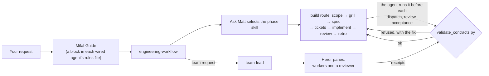

# Mifal

**A shared engineering workflow for the coding agents Mifal can wire on your Mac, plus a validator that checks their records when run; you still review the work.**

[](https://github.com/romiluz13/mifal/actions/workflows/test.yml)   [](LICENSE)

**[The Mifal website](https://romiluz13.github.io/mifal/)**: the build replay you can scrub through, the gate, and the install run.


<sub>A recorded run of Mifal 0.2.4 in a disposable home folder on macOS. The last command compares that folder with a snapshot taken before the install; the snapshot leaves out the working folder holding the clone and the <code>.cache</code> and <code>.npm</code> caches, and Herdr was already installed.</sub>

An agent's "done" message is not independent proof that the work passed its checks. Mifal detects five agent families (Claude Code, Codex, Droid, Pi and OpenCode) and installs one Guide into the selected homes it can wire; a precedence conflict or a symbolic rules file can make it skip an agent or refuse the install. It also installs the same 39 skills (Matt Pocock's engineering skills run as ordered phases, plus DDD, review and team leading) and a contract validator that refuses a brief, receipt or phase record that lacks its required fields and checks selected identities and hashes; it does not verify that tests ran or that skills were invoked. `--dry-run` previews the planned changes; a plain install prints a short summary and writes. Uninstall removes what Mifal wrote that is unchanged and keeps any file you edited.

## What you get

- 🧭 **One workflow, five agents.** For each selected home that can be wired, the installer adds the same Guide. The Guide instructs the agent to load `engineering-workflow` before an engineering request; Mifal does not force that invocation. A multi-session build runs scope → grill → spec → tickets → implement → review → retro in order; research, planning, debugging and review take shorter routes. `mifal doctor` checks the recorded install, the Guide blocks and the configured skill paths; it does not start agents or prove they loaded the Guide or the skills.
- 🛡️ **Gates that refuse.** The Guide has the agent run `validate_contracts.py` before every dispatch, review and acceptance. A record that lacks its required fields is refused with a diagnostic, and a passing record still needs its cited work and evidence reviewed:

  ```text
  $ python3 ~/.agents/skills/team-lead/scripts/validate_contracts.py brief .team/tasks/7.md --matt
  error: .team/tasks/7.md: missing section '## Done means'; the brief contract requires: Why, Outcome, Done means, Stop rule
  error: .team/tasks/7.md: missing '## Workflow' for the Matt check; add one before '## Return', e.g.:
    ## Workflow
    Methodology: matt
    ...
  ```
- ↩️ **Previewed, and undone where unchanged.** `--dry-run` lists the planned changes before anything changes. Your own rules files keep everything you wrote; Mifal adds one Marked block. `mifal uninstall` removes unchanged managed files, links and blocks, preserves your edits and additions, and restores a moved-aside backup only when its target is free (otherwise it keeps and reports the backup); Herdr stays installed.
- 👥 **A team, not a single chat.** The team lead skill has the lead brief agents in [Herdr](https://herdr.dev) panes, check their receipts with the validator, and send their work to a reviewer before accepting it, as in the replay above.

## Quickstart

You need macOS, git and Python 3.9 or later; verify them with `git --version` and `python3 --version` (`xcode-select --install` provides them on the tested Mac). The dry run lists every write and changes nothing. If Herdr is missing, the installer runs `brew install herdr`, which the dry run shows first; without Homebrew, in a terminal it downloads Herdr's install script, shows its checksum and asks before running it, and without a terminal it stops unless you pass `--herdr-script`.

```sh
git clone https://github.com/romiluz13/mifal.git
cd mifal
./install.sh --dry-run
./install.sh
```

The install puts the `mifal` command in `~/.local/bin`; if that folder is not on your PATH, the installer prints the line to add to `~/.zprofile`. Then check the install:

```sh
mifal doctor
```

Start a session in any agent Mifal wired, in a project folder, and ask for engineering work as you normally would. The Guide tells the agent to scope the request, ask whether you want the full workflow or a cut, and work phase by phase. For a team, start the session inside Herdr (`herdr`) and ask for one.

## Built by its own team


Mifal 0.1 was built by a Mifal team: a Claude lead, a Codex reviewer, a Claude researcher, and an outside critic for the final plan. Every mark is an event from the build record and `git log`. The reviewer said HOLD five times, with 21 blocking findings across those rounds (a few were what remained of an earlier finding), and all were closed before the public release.

## How it works



By default, Mifal's files live in your home folder: the engine in `~/.agents/mifal/`, the skills in `~/.agents/skills/`, and one Marked block in each successfully wired agent's rules file; an outside-home root needs `--allow-root-outside-home`, and Herdr's installation has its own effects described in INSTALL.md. [docs/INSTALL.md](docs/INSTALL.md) lists every write, and covers update, rollback and uninstall.

## Status

**Alpha**, version 0.3.0. The installer, update, uninstall, doctor and validator are covered by tests, run in CI on macOS under the system Python and the current python3. What a program checks, and what still relies on the agent following the Guide, is spelled out in [docs/TRUST.md](docs/TRUST.md).

## Support

This matrix is provisional. It records one live check on one Mac on 2026-10-25, run on the 0.2.4 code before this release's changes; the session records are kept by the maintainer, not in this repository. Each row is one agent version and one model. A level means:

- **L1 Guide and skills**: a first session quotes the Guide and names Mifal's skills.
- **L2 method, working alone**: before editing, the agent shows its route and checklist and asks "Full workflow or cut?". This is the entry gate.
- **L3 team worker**: the agent completes a brief from a lead and passes `receipt --matt`, with one ring to the lead.
- **L4 team lead**: one lead, one worker, one small task (a failing test in a small fixture), delivered through Herdr; both records pass the validator.

| macOS agent (version, model) | L1 Guide and skills | L2 method, alone | L3 team worker | L4 team lead |
|---|---|---|---|---|
| Claude Code 2.1.310, Sonnet 5.5 | partial | partial | pass | pass |
| Claude Code 2.1.310, Opus 5.5 | pass | partial | pass | not run |
| Codex 0.164.0, GPT-6.1-Sol (`codex-work` home) | partial | partial | pass | pass |
| Droid 0.249.0, GLM 5.3 | partial | partial | pass | pass |
| Pi 1.4.0, Claude Sonnet 5 via GitHub Copilot (`pi -ne`) | partial | fail | pass | pass |
| OpenCode 1.19.4, GLM-5.3-Flash Free and DeepSeek V4.1 Flash Free | partial | fail | pass | pass |

Read the levels with these limits:

- **L2 is a limitation, not a pass on any agent.** The check asks for a phase-record file, and an agent working alone keeps its checklist in chat, so `validate_contracts.py workflow --gate entry` has nothing to run on. Pi and OpenCode (two attempts each) edited before asking.
- **L1 is partial where a skill went unnamed or the Guide never arrived.** Claude Code with Sonnet, Droid and Pi did not name `ask-matt`, and Pi's own skill list lacked `engineering-workflow` and `team-lead`. On the 0.2.4 code, Codex (its `codex-work` home) and OpenCode received no Guide. This release writes OpenCode's `~/.config/opencode/AGENTS.md`, and the installer serves the Codex home that `CODEX_HOME` names; neither has been rechecked live yet.
- **The lead loop is experimental.** The Herdr adapter and the lead loop under `~/.agents/mifal/tools/` are tested with fake agents; the L4 column is one real small task per row, not a measure of reliability.
- **Skill filters are invisible to `mifal doctor`.** Agent-level settings can hide Mifal's skills while doctor passes: Pi's `skills` setting (and a `.gitignore` inside a skills folder, which Pi honours), Droid's `disabledSkills`, Codex's `[[skills.config]]`, and OpenCode's `permission.skill`. In the recorded run Pi hid nine of Mifal's skills, including `engineering-workflow` and `team-lead`, because of a `.gitignore` in the skills folder.
- **There is no sandbox or isolation between agents.** Worktrees are a Guide rule, not enforced; recovery from a stuck worker is one budgeted resume action that the lead runs, not a watchdog.

Linux and Windows are not supported in this release.

Keep the clone you installed from: `mifal update` and `mifal doctor`'s completeness check read it. Deleting it leaves the installed skills and rules in place, but you would then clone Mifal again to update.

## Docs

- [docs/INSTALL.md](docs/INSTALL.md): what gets written, and the install, update, rollback and uninstall path.
- [docs/TRUST.md](docs/TRUST.md): what is checked by a program, and what relies on the agent.
- [MAINTAINING.md](MAINTAINING.md): how upstream skill, Herdr and agent changes get into Mifal, and how Mifal's changes go back upstream.

## Credits

Mifal ships the work of others under their licences, recorded per component and skill in [`third_party/provenance.json`](third_party/provenance.json), each licence text beside its component (most in [`third_party/licenses/`](third_party/licenses), Impeccable's and LottieFiles' in `skills/frontend-design/references/interface/licenses/`) and summarised in [`NOTICE`](NOTICE): Matt Pocock's skills, DDD, Superpowers, agent-browser, Anthropic's frontend-design, Herdr's skill, Impeccable and LottieFiles motion-design. Mifal itself is MIT ([`LICENSE`](LICENSE)).
