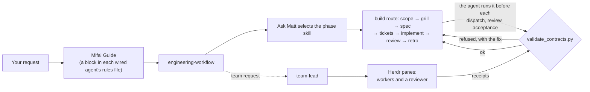

# Mifal

**One engineering workflow for the coding agents on your Mac, and the paperwork it leaves behind: a brief that names every claim, a receipt that answers each one, and a validator that refuses a record missing its required sections.**

[](https://github.com/romiluz13/mifal/actions/workflows/test.yml)   [](LICENSE)

**[The Mifal website](https://romiluz13.github.io/mifal/)**: the build replay you can scrub through, the gate, and the install run.


<sub>A real run of Mifal 0.1.1 in a disposable home folder on macOS. The last command compares that folder with a snapshot taken before the install; the snapshot leaves out the working folder holding the clone and the <code>.cache</code> and <code>.npm</code> caches, and Herdr was already installed.</sub>

Claude Code, Codex, Droid, Pi and OpenCode each read their own rules file, and each will tell you "done" whether or not it has proof. Mifal detects the five agent families and gives each agent it can wire the same Guide; a precedence conflict or a symbolic rules file can make it skip an agent or refuse the install. All wired agents also get the same 39 skills (Matt Pocock's engineering skills run as ordered phases, plus DDD, review and team leading) and a contract validator that refuses a brief, receipt or phase record missing its required fields or sections, and checks the identities and hashes it can. Every write is previewed first, and uninstall removes what Mifal wrote that is unchanged, keeping any file you edited.

## What you get

- 🧭 **One workflow, five agents.** Each agent Mifal wires gets the same Guide in its own rules file. The Guide has the agent load `engineering-workflow` before any engineering request, open by naming its owner, route, phase and next gate, and ask whether you want the full workflow or a cut; the wiring is installed, the invocation is not forced. A multi-session build then runs scope → grill → spec → tickets → implement → review → retro in order, while research, planning, debugging and review take shorter routes. `mifal doctor` checks the recorded install, the Guide block and the 39 skills; it does not start an agent to prove it loaded them.
- 📋 **A brief, not a prompt.** The lead writes each task as a file before work starts: why it matters, what done looks like, the claims that must hold with the check behind each one, a stop rule, and the line it is **least sure of**, the assumption most likely wrong and the observation that would settle it. That line replaces "any concerns?", which gets silence or invented objections.
- 🧾 **A receipt, not a "done".** The worker answers every claim in the brief with passed, failed or untested, cites the revision it checked and points at what it ran; a claim it does not address counts as untested, never as passed.
- 🛡️ **Gates that refuse.** The Guide has the agent run `validate_contracts.py` before every dispatch, review and acceptance. A record that is missing a required section is refused with a diagnostic, and a passing record still needs its cited work reviewed:

  ```text
  $ python3 ~/.agents/skills/team-lead/scripts/validate_contracts.py brief .team/tasks/7.md --matt
  error: .team/tasks/7.md: missing section '## Done means'; the brief contract requires: Why, Outcome, Done means, Stop rule
  error: .team/tasks/7.md: missing '## Workflow' for the Matt check; add one before '## Return', e.g.:
    ## Workflow
    Methodology: matt
    ...
  ```

  The validator reads records; it does not run your tests or prove an agent loaded a skill. [docs/TRUST.md](docs/TRUST.md) draws that line.
- ↩️ **Previewed, and undone where unchanged.** `--dry-run` lists the planned changes before anything changes. Your own rules files keep everything you wrote; Mifal adds one Marked block. `mifal uninstall` removes unchanged managed files, links and blocks, preserves your edits and additions, and restores a moved-aside backup only when its target is free (otherwise it keeps and reports the backup); Herdr stays installed.
- 👥 **A team, not a single chat.** The team lead skill has the lead brief agents in [Herdr](https://herdr.dev) panes, check their receipts with the validator, and send their work to a reviewer before accepting it, as in the replay above.

## Where the lead's authority ends

The lead is an agent too, so Mifal trusts it no further than its evidence. The validator refuses a record that breaks the rules below where it can check them; the Guide puts all four in front of the lead on every task.

- **It cannot approve its own plan.** Another agent grills the plan in rounds until no question is left open, and the validator refuses a grilling owned by the plan's author. A design change needs a new grilling; a scope change does not.
- **It cannot cut a step.** Only the person who asked can drop part of the workflow, and the cut is recorded in their own words with where they said it: `Cut: <steps> | <quote> | <source>`. Silence is not a cut.
- **It cannot accept a claim it cannot check.** At acceptance the receipt is re-checked against the revision on disk, and a failed check comes back as a new attempt rather than an acceptance.
- **It cannot blame the model first.** When work fails, the lead checks the brief, the context and the tools before it changes the assignment, and it treats "everyone agreed" as a warning rather than proof: agents are trained to agree. The output is one rule with a trigger, an owner and a check.

## Quickstart

You need macOS, git and Python 3.9 or later (`xcode-select --install` provides both). The dry run lists every write and changes nothing. If Herdr is missing, the installer runs `brew install herdr`, which the dry run shows first; without Homebrew, in a terminal it downloads Herdr's install script, shows its checksum and asks before running it, and without a terminal it stops unless you pass `--herdr-script`.

```sh
git clone https://github.com/romiluz13/mifal.git
cd mifal
./install.sh --dry-run
./install.sh
```

The install puts the `mifal` command in `~/.local/bin`; if that folder is not on your PATH, the installer prints the line to add to `~/.zprofile`. Then check the install:

```sh
mifal doctor
```

Start a session in any agent Mifal wired, in a project folder, and ask for engineering work as you normally would. The Guide tells the agent to scope the request, ask whether you want the full workflow or a cut, and work phase by phase. For a team, start the session inside Herdr (`herdr`) and ask for one.

## Built by its own team


Mifal 0.1 was built by a Mifal team: a Claude lead, a Codex reviewer, a Claude researcher, and an outside critic for the final plan. Every mark is an event from the build record and `git log`. The reviewer said HOLD five times, with 21 blocking findings across those rounds (a few were what remained of an earlier finding), and all were closed before the public release.

## How it works



By default, Mifal's files live in your home folder: the engine in `~/.agents/mifal/`, the skills in `~/.agents/skills/`, and one Marked block in each successfully wired agent's rules file; an outside-home root needs `--allow-root-outside-home`, and Herdr's installation has its own effects described in INSTALL.md. [docs/INSTALL.md](docs/INSTALL.md) lists every write, and covers update and uninstall.

## Status

**Alpha.** The installer, update, uninstall, doctor and validator are covered by tests, run in CI on macOS under the system Python and the current python3. What a program checks, and what still relies on the agent following the Guide, is spelled out in [docs/TRUST.md](docs/TRUST.md).

## Support

This matrix is provisional. A cell is filled only from a recorded live check: a first session that quotes the Guide and lists Mifal's skills, and a lead that dispatches a task to that agent through Herdr and receives its reply.

| Platform | Claude Code | Codex | Droid | Pi | OpenCode |
|---|---|---|---|---|---|
| macOS | untested | untested | untested | untested | untested |

Linux and Windows are not supported in this release. Droid's rules file location is documented by Factory, not yet confirmed live.

Keep the clone you installed from: `mifal update` fetches there, and reinstalling needs it. Deleting it leaves the installed skills and rules in place, but you would then clone Mifal again to update.

## Docs

- [docs/INSTALL.md](docs/INSTALL.md): what gets written, update and uninstall.
- [docs/TRUST.md](docs/TRUST.md): what is checked by a program, and what relies on the agent.
- [MAINTAINING.md](MAINTAINING.md): how upstream skill, Herdr and agent changes get into Mifal, and how Mifal's changes go back upstream.

## Credits

Mifal ships the work of others under their licences, recorded per component and skill in [`third_party/provenance.json`](third_party/provenance.json), each licence text beside its component (most in [`third_party/licenses/`](third_party/licenses), Impeccable's and LottieFiles' in `skills/frontend-design/references/interface/licenses/`) and summarised in [`NOTICE`](NOTICE): Matt Pocock's skills, DDD, Superpowers, agent-browser, Anthropic's frontend-design, Herdr's skill, Impeccable and LottieFiles motion-design. Mifal itself is MIT ([`LICENSE`](LICENSE)).
